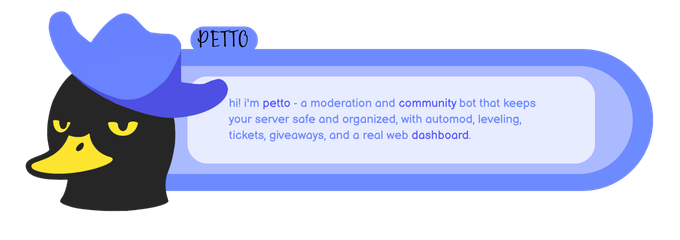
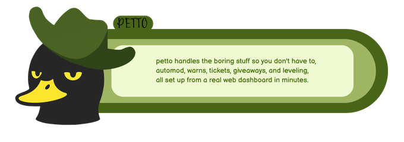
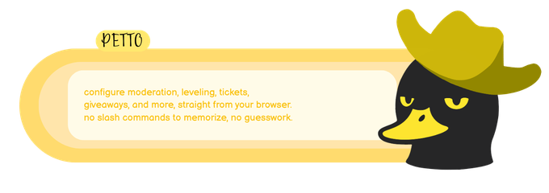

<div align="center">
  
  <h1>petto-web</h1>
  <p>The official website and web dashboard of Petto, where server owners learn about the bot and configure it without typing commands.</p>
  <p>
    <a href="https://petto.sbs">Website</a> ·
    <a href="https://petto.sbs/dash">Dashboard</a> ·
    <a href="https://petto.sbs/support">Support</a> ·
    <a href="https://github.com/PettoBot/petto-bot">Bot repository</a> ·
    <a href="https://github.com/PettoBot/petto-wiki-docs">Documentation</a>
  </p>
</div>

<div align="left">
  
</div>

**Overview**

petto-web is the front door of [Petto](https://github.com/PettoBot/petto-bot). It hosts the public pages that explain the bot and the dashboard where server managers configure it with forms, toggles, and dropdowns. It is built with Astro 4 and React islands and deployed on Cloudflare. The public pages are static. The dashboard (`/dash/**`) runs on the server for every request, because it needs a live Discord session to know which servers you can manage. It never touches the database directly and talks to the bot through a private API.

<div align="left">
  
</div>

**What the site includes**

- **Public pages:** home, commands, FAQ, roadmap, changelog, blog, team, partners, status, and legal pages, in English, Spanish, and Portuguese.
- **Server dashboard:** available in English, Spanish, and Brazilian Portuguese (picked with the language menu, remembered in the `petto_lang` cookie). One module per area of the bot, including moderation, leveling, tickets, giveaways, logging, security, onboarding, community, automation, backups, and permissions.
- **Embed builder:** a React island with live preview, up to 10 embeds, and 5 rows of buttons.
- **Premium:** plans, checkout through Polar, and owner grants at `/dash/admin`.
- **Discord login:** OAuth2 sign in, linked roles, and a per-server permission check on every dashboard page.

<div align="left">
  
</div>

**Running it locally**

```bash
npm install
npm run dev
npm run check
npm run build
```

The dev server runs at `http://localhost:4321`. Always run `npm run check` and `npm run build` before calling a change done, since there is no test suite.

`astro.config.mjs` loads the credentials from the bot's `.env`, expected at `../petto bot 1/.env`. If your bot folder is named differently, update that path, or the dashboard will have no Discord or bot API credentials in development.

**Environment variables**

| Variable | Used for |
| --- | --- |
| `DISCORD_TOKEN` | Bot token. Reads guild, role, and channel data, and the team profiles on `/team` at build time. |
| `DISCORD_CLIENT_ID` | OAuth2 login and the Add Bot invite links. |
| `DISCORD_CLIENT_SECRET` | OAuth2 code exchange and signing the session cookie. Server-side only. |
| `PETTO_BOT_API_URL` | Private bot API used by the dashboard for all database-backed data. |
| `PETTO_BOT_API_SECRET` | Server-side key matching the bot's `PETTO_DASHBOARD_API_SECRET`. Never expose it to the browser. |
| `POLAR_ACCESS_TOKEN` | Server-side secret used to create a checkout tied to the logged-in Discord user. |
| `POLAR_WEBHOOK_SECRET` | Secret used by `petto.sbs/api/billing/polar/webhook` to verify Polar events. |
| `PETTO_OWNER_ID` | Discord ID allowed to use `/dash/admin` for permanent Premium grants. |
| `PETTO_FORMS_WEBHOOK_URL` | Discord webhook that receives the applications sent from `/apply` (developer, manager, partner, and staff). Without it the forms show as closed. |
| `PETTO_DATABASE_URL` | Optional, Discloud (Node) only. The bot's PostgreSQL, read and written directly by the dashboard (see the Discloud checklist). Set it in production: without it every dashboard read and write goes through the bot API, which is rate limited. `PETTO_DATABASE_SSL=true` when the database needs TLS. |
| `PETTO_DATABASE_POOL_MAX` | Optional. Most connections the dashboard opens to that database at once (default 15; 2 are kept open). |
| `REDIS_URL` or `DISCLOUD_REDIS_URL` | Optional, Discloud (Node) only. The bot's Redis. The dashboard keeps its shared cache there (keys under `petto:web:`), reads the bot's copy of each server from `petto:snap:<id>`, listens to `petto:snap` and `petto:guilds`, and publishes `petto:invalidate` after a direct database write. Without it everything is kept in memory, as before. `PETTO_REDIS_TIMEOUT_MS` (default 150) is how long a Redis command may take before Redis is skipped for a while. |

**Deploying**

The Cloudflare adapter is already configured with `output: 'hybrid'`, so it deploys as is. Workers do not read `.env` files, so every variable above must be set in the Cloudflare dashboard as an encrypted variable. `/team` also needs `DISCORD_TOKEN` at build time, since it fetches each team member's live Discord profile while the site is built. The public product IDs and checkout link live in `wrangler.toml`.

For Discloud, register the web subdomain first, put it in the `ID` of `discloud.config`, and upload the project with the Node standalone build. The site must listen on `0.0.0.0:8080`, which `server.mjs` (at the root, because Discloud checks `MAIN` before it builds) sets by default while still honoring an explicit `HOST` or `PORT`. Set `PETTO_BOT_API_URL` and `PETTO_BOT_API_SECRET` as runtime variables there.

### Discloud, fast deploys

Compiling on Discloud takes minutes (its builder compiles, and the running container compiles again). The `Discloud prebuilt` workflow (`.github/workflows/discloud-prebuilt.yml`) builds the site on GitHub after every push to `main` and publishes the result to the `discloud` branch: the compiled site, `server.mjs`, `discloud.config` and a `package.json` with only the packages the site needs to run and no build script. Point Discloud at the `discloud` branch and it only installs the packages and starts. The footer (`v0.2.179`) and `/version.json` say which build is running; raise the version in `package.json` with each change you want to recognize. The same folder can be made by hand with `npm run build:discloud && npm run package:discloud` (output in `discloud-dist/`).

### Discloud checklist

1. Copy `.env.discloud.example` to `.env` and fill the secrets with the same values the Cloudflare dashboard has. The site keeps no data of its own: logins are signed cookies (keyed by `DISCORD_CLIENT_SECRET`) and everything else is read from the bot API, so moving hosts loses nothing and keeps people logged in.
2. Discloud's own builder runs `npm run build` inside `/home/node`, and `scripts/build.mjs` picks the Node build there by itself (Cloudflare stays the default; `npm run build:discloud` or `ASTRO_TARGET=discloud` force it). Zip the project root (`.discloudignore` already leaves out `node_modules`, `dist` and docs) and upload it. Discloud runs `npm run build:discloud` and then `npm run start:discloud`.
   If the running container comes up without the `build/` folder, `server.mjs` builds the site itself on the first start. That needs about 800 MB of RAM for a few minutes, which is why `discloud.config` asks for `RAM=1024`; with 512 MB the build is killed half way.
3. Point the domain at Discloud, and update the Discord OAuth redirect and the Polar webhook only if the address changes.
4. Set `PETTO_DATABASE_URL` in production (and `PETTO_DATABASE_SSL=true` if your database needs it) to the same database the bot uses. Without it every page reads and writes through the bot API, which is slower and rate limited. With it, simple reads and the dashboard's writes are answered straight from PostgreSQL (`src/utils/directDb.ts`), and the statistics and overview pages add their numbers up in the database. Nested selects, `and` filters and anything unusual still go through the bot API, and so does everything while the database is unreachable. The Cloudflare build never includes this code.
5. Optionally set `REDIS_URL` (or `DISCLOUD_REDIS_URL`) to the bot's Redis. Server lists, member names, emojis and the bot's copy of each server are then shared through it and dropped the moment the bot says they changed; a slow or missing Redis is skipped and the site works from memory. Dashboard responses carry a `Server-Timing` header (auth, db, discord, bot, render); `npm run load:check` with `LOAD_TEST_COOKIE` (a `petto_session` value) and `LOAD_TEST_PATHS` (comma-separated dashboard paths) prints it per page.

**Applications**

The `/apply` page has four forms: developer, manager, partner, and staff. Each submission is posted as an embed to the Discord webhook in `PETTO_FORMS_WEBHOOK_URL`, with no mentions enabled. If the visitor is logged in with Discord, the embed shows their verified account. Otherwise it says the Discord user was typed by the applicant. The fields and validation live in `src/utils/applications.ts`, and the texts in `src/data/applicationCopy.ts`.

**Commands page**

The commands reference is generated from the bot. After the bot's commands change, run `npm run sync:commands -- "<path to petto-bot>"` (or set `PETTO_BOT_DIR`), then add the translated description of any new command in `src/data/commandText.ts` and its category in `src/data/commandCatalog.ts`.

**Project layout**

```text
src/
  pages/          One file per route. Locale copies live in es/ and pt-br/.
    dash/         Everything behind Discord login.
  components/     Page components. Dash*.astro are the dashboard modules.
  layouts/        Base layout with nav, footer, theme toggle, and global CSS.
  react/embeds/   The embed builder, the only React island.
  utils/discordPreview.ts  Draws Discord-style messages for the dashboard previews.
  utils/embedSchema.ts     Template shape, limits, validation, and share codes.
  utils/embedSend.ts       Builds and sends the dashboard's test messages.
  i18n/ui.ts      Every public string, for all locales.
  i18n/dash*.ts   Dashboard texts. The English text is the key, dash-es.ts and dash-pt.ts translate it.
  utils/          Session, Discord API, and dashboard auth.
```

To add a page, build the component in `src/components/`, add its strings to every locale in `src/i18n/ui.ts`, and create the route in `src/pages/`, `src/pages/es/`, and `src/pages/pt-br/`.

Dashboard texts are wrapped in `dt('English text')` (or `dth` when the text has HTML, `cdt` in browser scripts). Add the translation to `src/i18n/dash-es.ts` and `src/i18n/dash-pt.ts`, then run `node scripts/check-dash-i18n.mjs` to list any text that is still missing. A missing entry just shows in English.

To add a dashboard module, follow the shape of the pages under `src/pages/dash/guild/[id]/`: verify the session with `getGuildSession`, redirect when it fails, and batch every Discord and bot API call in a single `Promise.all`. Anything interpolated into a database API filter must go through `encodeURIComponent`.

**Design notes**

`docs/embed-integration.md` is a proposal for connecting the Embed Generator, the bot, and the dashboard.

**Contributing**

Petto is maintainer-led. Read the [contribution guide](CONTRIBUTING.md), [AI-assisted development policy](AI_POLICY.md), [governance](GOVERNANCE.md), [security policy](SECURITY.md), [code of conduct](CODE_OF_CONDUCT.md), [support guide](SUPPORT.md), and [DCO](DCO.md) before proposing a change.

Feature ideas and behavior changes should be discussed and accepted before implementation. Never commit credentials, environment files, private deployment data, or database exports.
